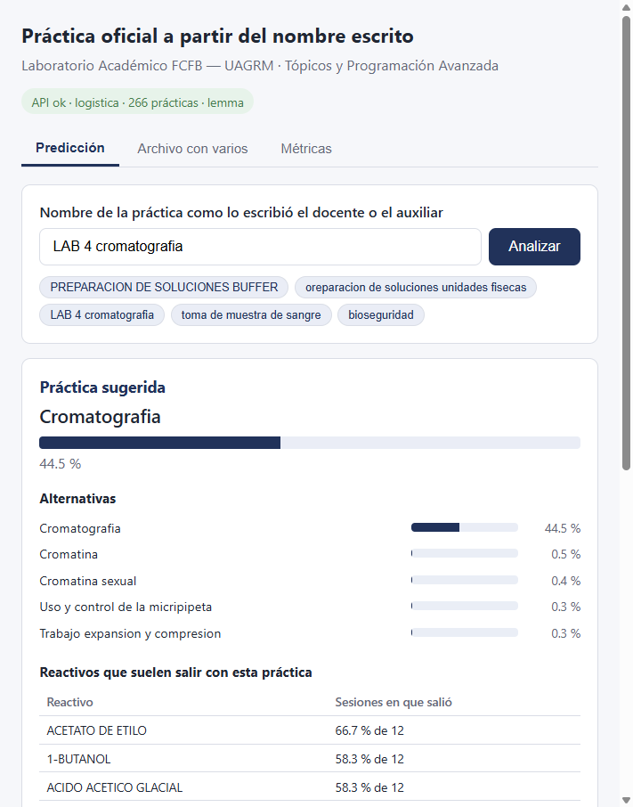
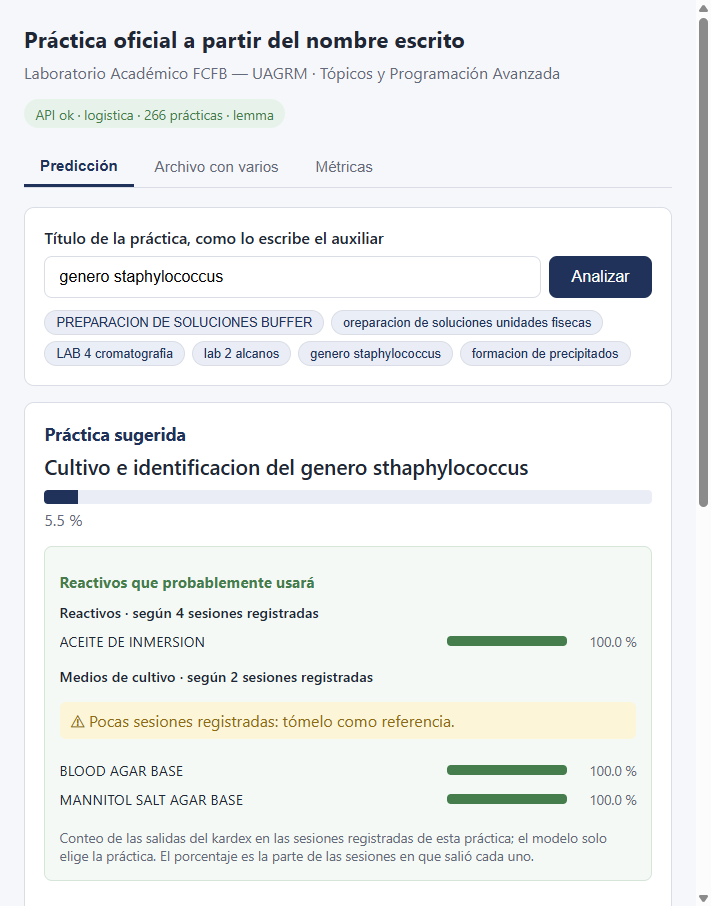

# Práctica oficial a partir del nombre escrito

Proyecto integrador de **Tópicos y Programación Avanzada** (primer parcial). Clasifica el nombre de una práctica de laboratorio, escrito a mano por docentes y auxiliares, en la **práctica oficial del catálogo**. Luego muestra los reactivos que el kardex asoció a esa práctica. Los datos vienen del Laboratorio Académico de la FCFB — UAGRM, y el servicio está pensado para integrarse al sistema BioFarm.

- Tarea: clasificación de texto en español, con 266 prácticas y 4.565 nombres etiquetados.
- NLP: normalización, tokenización, stop words, stemming (Snowball) y lematización (spaCy) comparados, n-gramas y TF-IDF.
- Modelos: regresión logística (en producción) y Naive Bayes, comparados contra dos líneas base.
- Backend: FastAPI. Frontend: React + Vite.

Informe técnico: [`docs/informe.md`](docs/informe.md) · Diapositivas: [`docs/diapositivas.pptx`](docs/diapositivas.pptx) · Notebook: [`notebooks/01_eda_y_experimentos.ipynb`](notebooks/01_eda_y_experimentos.ipynb)



## Resultados

| Modelo | macro-F1 CV | Exactitud prueba | Exactitud prueba manual |
|---|---|---|---|
| **Regresión logística** (lemma, palabras 1–2 + caracteres 3–5, C=0,3) | **0,887** | **0,970** | **0,902** |
| Naive Bayes (Complement, stem, alpha=0,1) | 0,689 | 0,871 | 0,878 |
| Regla de similitud (rapidfuzz) | — | 1,000* | 0,756 |
| Clase más frecuente | — | 0,003 | 0,037 |

\* La regla armó las etiquetas de esa prueba. La prueba manual tiene textos que la regla no supo unir, etiquetados a mano. El detalle está en el informe.

## Instalación desde cero

Requisitos: Python 3.12 y Node.js 20 o superior.

```bash
git clone <url-del-repo> topicos-practica-nlp
cd topicos-practica-nlp

# Backend y modelo
python -m venv .venv
.venv\Scripts\activate            # Windows  (Linux/macOS: source .venv/bin/activate)
pip install -r requirements.txt   # incluye el modelo es_core_news_sm de spaCy

# Frontend
cd frontend
npm install
cd ..
```

## Ejecutar

En dos terminales:

```bash
# 1. API  ->  http://localhost:8000  (documentación en /docs)
uvicorn api.main:app --port 8000

# 2. Frontend  ->  http://localhost:5173
cd frontend
npm run dev
```

El modelo ya entrenado está en `models/pipeline.joblib`, así que no hace falta entrenar para usar el sistema.

## Reentrenar (un solo comando)

```bash
python -m src.models.entrenar
```

Parte de los CSV sin datos de personas (`data/processed/dataset.csv` y `data/etiquetas/`). Compara stemming y lematización, unigramas, uni + bigramas y uni + bi + caracteres, con los tres modelos. Ajusta `C` y `alpha` con validación cruzada y guarda `models/pipeline.joblib`, `models/metricas.json` y `models/experimentos.csv`. La semilla es 42 y tarda unos 3 minutos.

Para regenerar todo desde las planillas originales (no versionadas porque tienen datos personales; ver [`data/raw/README.md`](data/raw/README.md)):

```bash
python -m src.models.entrenar --desde-crudos
```

## Pruebas

```bash
pytest -q
```

## Ejemplo de la API

```bash
curl -X POST http://localhost:8000/predecir -H "Content-Type: application/json" \
     -d "{\"texto\": \"LAB 4 cromatografia\"}"
```

```json
{
  "practica": "Cromatografia",
  "probabilidad": 0.4455,
  "confirmar": false,
  "alternativas": [{"practica": "Cromatografia", "probabilidad": 0.4455}, "..."],
  "reactivos_sugeridos": [
    {"reactivo": "ACETATO DE ETILO", "tipo": "reactivo", "proporcion": 0.667, "sesiones": 12},
    {"reactivo": "1-BUTANOL", "tipo": "reactivo", "proporcion": 0.583, "sesiones": 12}, "..."
  ],
  "base_reactivos": "practica",
  "siglas_base": []
}
```

La lista de reactivos sale por conteo, no del modelo. Para cada práctica se cuenta en qué parte de sus sesiones salió cada reactivo, del kardex de reactivos, o cada medio de cultivo, del kardex de microbiología. Se muestran hasta 12 por tipo, desde el 25 % de las sesiones. Si la práctica no tiene salidas propias, `base_reactivos` vale `"asignatura"` y se muestran los reactivos más usados en sus siglas. Hay sugerencia para 260 de las 266 prácticas: 200 con su propio registro y 60 por asignatura.



## Estructura

```
data/
  raw/          planillas originales (no versionadas)
  processed/    atenciones, kardex, microbiología, dataset, catálogo y reactivos por práctica (sin personas)
  etiquetas/    variantes.csv, fusiones_manuales.csv, prueba_manual.csv
notebooks/      análisis exploratorio y experimentos
src/
  data/         extracción y etiquetado
  nlp/          pipeline de preprocesamiento
  models/       construcción del pipeline y entrenamiento
api/            FastAPI
frontend/       React + Vite
tests/          pytest
docs/           informe, diapositivas y capturas
models/         pipeline.joblib, metricas.json, experimentos.csv
```
