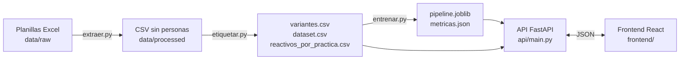

# Informe técnico — Práctica oficial a partir del nombre escrito

Tópicos y Programación Avanzada · Proyecto integrador, primer parcial · Diego Saavedra · noviembre 2026

## 1. Problema

En el Laboratorio Académico de la FCFB — UAGRM, cada sesión de laboratorio se registra a mano: el docente o el auxiliar escribe el nombre de la práctica en la planilla de atenciones y en el kardex de reactivos. El mismo trabajo aparece escrito de muchas formas. Solo «preparación de soluciones a un pH determinado» tiene más de veinte escrituras («de un ph determinado», «con un ph determinado», «de un phdeterminado», «LAB 4 …», con errores como «prepraracion» u «oreparacion»).

En el sistema BioFarm (ERP de inventarios del laboratorio), el auxiliar ya entra con su carrera y sus grupos. Lo que falta resolver es el nombre libre: sin un nombre oficial no se puede saber qué reactivos suele llevar una práctica.

**Tarea:** clasificación de texto. Entrada: el nombre escrito. Salida: la práctica oficial del catálogo, con su probabilidad. Con la práctica identificada, el sistema muestra los reactivos que el kardex asoció a ella. **Esa lista sale por conteo del historial, no del modelo**: el modelo solo elige la práctica.

Se descartó predecir la carrera (FAR / BQM), porque la sesión del usuario ya la trae, y predecir los gramos con regresión, porque en 171 pares práctica–reactivo medidos 4 veces o más la cantidad varía demasiado.

## 2. Dataset

| | |
|---|---|
| Origen | Planillas internas del Laboratorio Académico FCFB — UAGRM: `ATENCION 2026 JULIO AGOSTO SEPTIEMBRE.xlsx` (hoja `ATENCION 2026`, marzo a octubre de 2026) y los dos kardex de reactivos (controlados y no controlados) |
| Fecha de obtención | 25 de octubre de 2026 |
| Licencia | Datos no públicos, de uso académico con autorización del laboratorio. Las planillas crudas no se suben al repositorio |
| Idioma | Español |
| Privacidad | `src/data/extraer.py` quita docente, auxiliar, registros, códigos y firmas. Quedan nombre de práctica, carrera, asignatura, sigla, grupo, mes, reactivo y gramos |

| Medida | Valor |
|---|---|
| Atenciones FAR/BQM con nombre | 7.994 |
| Salidas de kardex | 4.376 (236 reactivos, 912 nombres de práctica) |
| Nombres crudos distintos en atenciones | 3.655 (3.160 claves tras normalizar) |
| **Filas etiquetadas** | **4.565** (atenciones + sesiones únicas del kardex) |
| **Prácticas oficiales (clases)** | **266**, de 8 a 82 filas cada una (mediana 13) |

### 2.1 Etiquetado (`src/data/etiquetar.py`)

No existía una columna con la práctica oficial. La etiqueta se construyó así:

1. Cada nombre se reduce a una **clave**: normalizado, sin stop words y sin tildes («LAB 4 Preparación de soluciones de un pH determinado» → `preparacion soluciones ph determinado`).
2. Las claves que aparecen 4 veces o más son candidatas a práctica oficial. Se recorren de la más frecuente a la menos frecuente.
3. Una clave se une a una práctica oficial **solo si todas sus palabras coinciden, palabra por palabra, en ambos sentidos**, con similitud `rapidfuzz` ≥ 84 por palabra. Así «unidades fisecas» se une a «unidades fisicas», pero «unidades físicas» no se une a «unidades químicas».
4. Hay palabras del dominio que difieren en una letra y no son errores de tipeo: alquenos / alquinos, mitosis / meiosis, éter / éster, metanol / etanol, colorimetría / calorimetría, disolución / dilución. Esas palabras deben coincidir exactas (`PALABRAS_EXACTAS`). Se encontraron revisando a mano las uniones automáticas.
5. `data/etiquetas/fusiones_manuales.csv` (15 filas, revisión manual) une prácticas que la regla dejó separadas y son la misma (por ejemplo, «punto de fusión» y «determinación del punto de fusión»).
6. Lo que no se une a nada queda **sin etiqueta y fuera del dataset**: se prefiere perder filas a meter etiquetas dudosas.

La tabla completa queda en `data/etiquetas/variantes.csv` (clave, práctica oficial, método y puntaje). Los nombres que mezclan dos prácticas en una sesión («alcanos y alquenos») quedan como su propia clase si son frecuentes, o sin etiqueta.

### 2.2 Hallazgos del análisis exploratorio (`notebooks/01_eda_y_experimentos.ipynb`)

- **Faltantes:** 75 atenciones sin nombre de práctica y 39 escritas como «sin nombre» (ambas excluidas). En el kardex faltan 2 siglas, 1 formulario y 7 cantidades.
- **Desbalance:** la clase más grande («Bioseguridad») tiene 82 filas y la mediana es 13. Por eso la métrica principal es **macro-F1** y la regresión logística usa `class_weight="balanced"`.
- **Textos cortos:** 677 de las 4.565 filas tienen una sola palabra («bioseguridad», «alcanos»), y la API las acepta.
- **Palabras frecuentes:** antes de quitar stop words dominan «de» (2.865), «y» y «del»; después, «soluciones», «preparación», «determinación», «laboratorio» y «observación».
- **Reactivos ubicuos:** el etanol al 96 % sale en 307 prácticas distintas y el aceite de inmersión en 188. La sugerencia de reactivos usa la proporción de sesiones **de esa práctica** (≥ 50 %), no «todo lo que alguna vez la acompañó».

## 3. Pipeline de NLP (`src/nlp/preprocesamiento.py`)

Orden: normalizar → tokenizar → quitar stop words → stemming o lematización → quitar tildes.

| Paso | Qué hace | Por qué |
|---|---|---|
| Normalización | Minúsculas. Corrige la tilde grave escrita por error (`INTRODUCCÌON` → `introducción`). Quita URLs, emojis, puntuación y números | Los números son numeración de guía («LAB 4», «práctica 3»), no distinguen la práctica. **Se conservan las tildes y la ñ en este paso** porque el lematizador de spaCy las necesita |
| Tokenización | Expresión regular sobre letras del español | Casos difíciles: `phdeterminado` (palabras pegadas), `ac` por «ácido», `e coli` (la `e` suelta se descarta), `rx` por «reacción» |
| Stop words | Lista de spaCy en español + palabras del dominio (`lab`, `practica`, `nro`, `parte`, `tema`) − palabras que aquí sí cambian la práctica (`simple(s)`, `medio(s)`, `general`, `total`, `primera`, `segunda`) | «Soluciones simples» y «soluciones» son prácticas distintas; «medio de cultivo» necesita «medio» |
| Stemming | Snowball (NLTK) en español | Une singular y plural (`tejidos epiteliales` = `tejido epitelial`) |
| Lematización | spaCy `es_core_news_sm` | Da palabras reales, pero falla con términos técnicos (`biotecnología` → `biotecnologio`) y con texto sin tildes |
| Quitar tildes | Al final; conserva la ñ | Une «preparación» con «preparacion» |

Ejemplo:

| | |
|---|---|
| Original | `LAB 4 PREPARACIÓN DE SOLUCIONES DE UN PH DETERMINADO` |
| Normalizado | `lab preparación de soluciones de un ph determinado` |
| Tokens | `lab · preparación · de · soluciones · de · un · ph · determinado` |
| Stop words eliminadas | `lab · de · de · un` |
| Stemming | `prepar solucion ph determin` |
| Lematización | `preparacion solucion ph determinado` |

**TF-IDF:** `min_df=1` (una escritura con error puede aparecer una sola vez y aún así ayuda), `max_df=0.5` (las palabras que están en más de la mitad de los nombres no distinguen prácticas), `max_features=5000` por vectorizador y `sublinear_tf=True`. Vocabulario final del modelo en producción: 5.920 términos (palabras más n-gramas de caracteres).

### 3.1 Comparación stemming / lematización y n-gramas (validación cruzada, macro-F1)

| Preprocesamiento | n-gramas | Regresión logística | Complement NB | Multinomial NB |
|---|---|---|---|---|
| stem | unigramas | 0,744 | 0,528 | 0,492 |
| stem | uni + bigramas | 0,691 | 0,597 | 0,487 |
| stem | uni + bi + caracteres 3–5 | 0,842 | **0,655** | 0,585 |
| lemma | unigramas | 0,713 | 0,515 | 0,447 |
| lemma | uni + bigramas | 0,653 | 0,563 | 0,455 |
| lemma | uni + bi + caracteres 3–5 | **0,873** | 0,645 | 0,577 |

- Con palabras solas, el **stemming gana** a la lematización (0,744 contra 0,713), porque spaCy falla con términos técnicos y con texto sin tildes.
- Los **bigramas de palabras solos no ayudan** a la regresión logística, aunque sí a Naive Bayes.
- Lo que más sube son los **n-gramas de caracteres** (`char_wb` 3–5): absorben errores de tipeo como `fisecas` o `prepraracion`, que con palabras completas quedan fuera del vocabulario. Con caracteres, la lematización queda apenas por encima del stemming.

## 4. Modelos (`src/models/`)

**Regresión logística** (multiclase, softmax). Aprende un peso por término de TF-IDF y por práctica, y la probabilidad de cada práctica sale de aplicar softmax a la suma ponderada. Es adecuada para texto disperso con muchas clases. Da probabilidades útiles para pedir confirmación y sus pesos se pueden interpretar. `class_weight="balanced"` compensa el desbalance.

**Naive Bayes (Complement NB).** Estima, para cada práctica, la probabilidad de cada término, suponiendo que los términos son independientes. Complement NB calcula esas probabilidades con los documentos que **no** son de la clase, lo que lo hace más estable con clases desbalanceadas que Multinomial NB (en los experimentos, Complement le gana a Multinomial en todas las configuraciones).

### 4.1 División y validación

- **Prueba:** las formas oficiales de cada práctica siempre entrenan, porque son el catálogo que BioFarm ya conoce. La prueba se toma de las **formas alternativas**, con `StratifiedGroupKFold` (2 particiones, semilla 42) agrupado por clave: una misma escritura nunca está en entrenamiento y en prueba. Resultado: 4.201 filas de entrenamiento y 364 de prueba, con 135 escrituras nunca vistas de 105 prácticas.
- **Validación cruzada:** 5 particiones con el mismo esquema dentro del entrenamiento. Con ella se comparan preprocesamientos y se ajustan hiperparámetros (`GridSearchCV`): `C` ∈ {0,3; 1; 3; 10; 30; 100} para la logística y `alpha` ∈ {0,01; 0,05; 0,1; 0,3; 1} para Naive Bayes.
- **Prueba manual:** 78 escrituras (82 textos) que la regla de etiquetado **no** supo unir, etiquetadas a mano (`data/etiquetas/prueba_manual.csv`). Nunca entrenan.

¿Por qué una prueba manual? Las etiquetas de la prueba automática las puso la misma regla de similitud, así que esa regla saca 1,0 en ella por construcción. Para medir si el modelo aporta algo sobre la regla hace falta texto que la regla no resolvió.

### 4.2 Resultados

| Modelo | Configuración | macro-F1 CV | macro-F1 prueba | Exactitud prueba | macro-F1 manual | Exactitud manual |
|---|---|---|---|---|---|---|
| **Regresión logística** | lemma · uni+bi+car · C=0,3 | **0,887** | **0,926** | **0,970** | **0,837** | **0,902** |
| Complement NB | stem · uni+bi+car · alpha=0,1 | 0,689 | 0,741 | 0,871 | 0,789 | 0,878 |
| Línea base: regla de similitud | práctica oficial más parecida (rapidfuzz) | — | 1,000* | 1,000* | 0,553 | 0,756 |
| Línea base: clase más frecuente | siempre «la práctica más común» | — | 0,000 | 0,003 | 0,001 | 0,037 |

\* La regla armó esas etiquetas: su resultado en la prueba automática no mide nada.

**En producción queda la regresión logística**, elegida por validación cruzada; ni la prueba ni la prueba manual decidieron nada. En la prueba manual acierta 90 % frente a 76 % de la regla de similitud: el modelo une escrituras que la regla no resuelve (`preparación de soluciones buffer` con su práctica, `ml iodometría`, `determinación del coeficiente gamma Clement`).

### 4.3 Análisis de errores

Los errores de la prueba manual y de la prueba automática se reparten en cuatro tipos:

1. **Práctica genérica contra práctica específica.** «PREPARACIÓN DE SOLUCIONES DE UN PHDETERMINADO» → «Preparación de soluciones»; «TOMA DE MUESTRA DE SANGRE» → «Toma de muestra». El texto comparte casi todas las palabras con la clase genérica, y la palabra que distingue está pegada o escrita de otra forma.
2. **El catálogo tiene casi duplicados.** «Uso de la micropipeta» frente a «Uso y control de la micripipeta», y «Examen general de orina» frente a «Examen general de orina (microscopía)». El modelo no está tan equivocado: esas clases deberían fusionarse cuando el laboratorio cierre el catálogo.
3. **Sinónimos que no están en entrenamiento.** «buffer» nunca aparece; en los datos se dice «tampón». El modelo duda entre varias «preparación de soluciones…» y la API pide confirmar.
4. **Nombres de una palabra con errores.** «BIOSEFURIDAD Y MICROSCOPIA» y «MICROSCOPIO». Con palabras de una sola sesión, los n-gramas de caracteres ayudan pero no alcanzan. Los nombres de una palabra aciertan 86 % en la prueba automática, frente a 97 % los de varias palabras.

**Probabilidades.** Con 266 clases y `C=0,3` (regularización fuerte), la probabilidad absoluta queda baja aunque el modelo acierte: en promedio 0,23 en los aciertos y 0,10 en los errores. Por eso la API no usa un umbral fijo. Pide confirmar cuando la primera opción no llega al doble de la segunda (`confirmar: true`).

## 5. Arquitectura

El pipeline guardado (`models/pipeline.joblib`) tiene tres pasos: `PreprocesadorTexto` → TF-IDF (palabras y caracteres) → regresión logística. La API lo carga y llama `predict_proba` con el texto crudo, **sin reimplementar el preprocesamiento**. Al entrenar y al predecir se usan el mismo código, la misma semilla (42) y las mismas versiones (`requirements.txt`).

Camino de una predicción:

1. El usuario escribe «LAB 4 cromatografia» en el frontend.
2. El frontend hace `POST /predecir` con `{"texto": "LAB 4 cromatografia"}`.
3. Pydantic valida: no vacío, ≤ 500 caracteres, con letras.
4. El pipeline normaliza, tokeniza, quita stop words y lematiza (`cromatografia`), vectoriza y devuelve una probabilidad por cada una de las 266 prácticas.
5. La API ordena las prácticas, toma la primera, decide si hay que confirmar y busca en `reactivos_por_practica.csv` los reactivos de esa práctica.
6. El frontend muestra «Cromatografía 44,5 %», las alternativas y los reactivos: acetato de etilo, butanol y ácido acético.

| Endpoint | Qué hace |
|---|---|
| `GET /salud` | Estado del servicio, modelo en producción y número de prácticas |
| `POST /predecir` | Práctica, probabilidad, alternativas, `confirmar` y reactivos sugeridos. Acepta `candidatas` (las prácticas de los grupos del auxiliar) para elegir solo entre ellas |
| `POST /preprocesar` | Cada paso del preprocesamiento (stem o lemma) |
| `GET /metricas` | Métricas, experimentos y errores |
| `GET /practicas` | Catálogo de prácticas |

La documentación interactiva queda en `http://localhost:8000/docs`. Las pruebas automatizadas están en `tests/` (16 pruebas con pytest): predicción conocida, error de tipeo, texto vacío, texto largo, formato incorrecto, candidatas y preprocesamiento.

## 6. Encaje en BioFarm

En BioFarm, la tabla `practicas` hoy guarda código, nombre, materia y estado, y el requerimiento deja elegir una práctica o escribir «Otra / personalizada». Cuando el catálogo por grupo esté cerrado:

1. El texto libre solo aparece si la práctica no está en la lista, o al importar una frase del Excel.
2. BioFarm le manda a esta API el texto y las prácticas de los grupos del auxiliar (`candidatas`), y recibe la práctica sugerida.
3. BioFarm muestra los reactivos de esa práctica por conteo. El auxiliar confirma, quita o agrega, y los gramos los sigue cargando él.
4. Los requerimientos nuevos guardan `practica_id`. A partir de ahí el conteo se actualiza con las salidas reales.

## 7. Limitaciones

- Las etiquetas salen de una regla más una revisión manual parcial: la tabla `variantes.csv` puede tener uniones discutibles en las clases chicas.
- La prueba manual es pequeña (82 textos) y se armó con candidatos que ya compartían palabras con alguna práctica.
- El catálogo de 266 prácticas no es oficial: lo tiene que cerrar el laboratorio. Los errores de tipo 2 muestran dónde fusionar.
- Las probabilidades no están calibradas. Sirven para ordenar las opciones, no como certeza.

## 8. Uso de asistentes de IA

Se usó un asistente de IA (Cursor, con un modelo de lenguaje) para escribir y revisar código, armar la estructura del repositorio, redactar este informe y generar el notebook. Las decisiones de dominio vienen del análisis previo del proyecto BioFarm (`docs/proyecto-integrador-modelo-practica.md` en el repositorio de BioFarm): qué predecir, qué datos usar y qué queda fuera del modelo. La revisión de las uniones automáticas y la prueba manual se hicieron a mano. Todo el código fue revisado, ejecutado y probado por el autor, que puede explicarlo y modificarlo.
